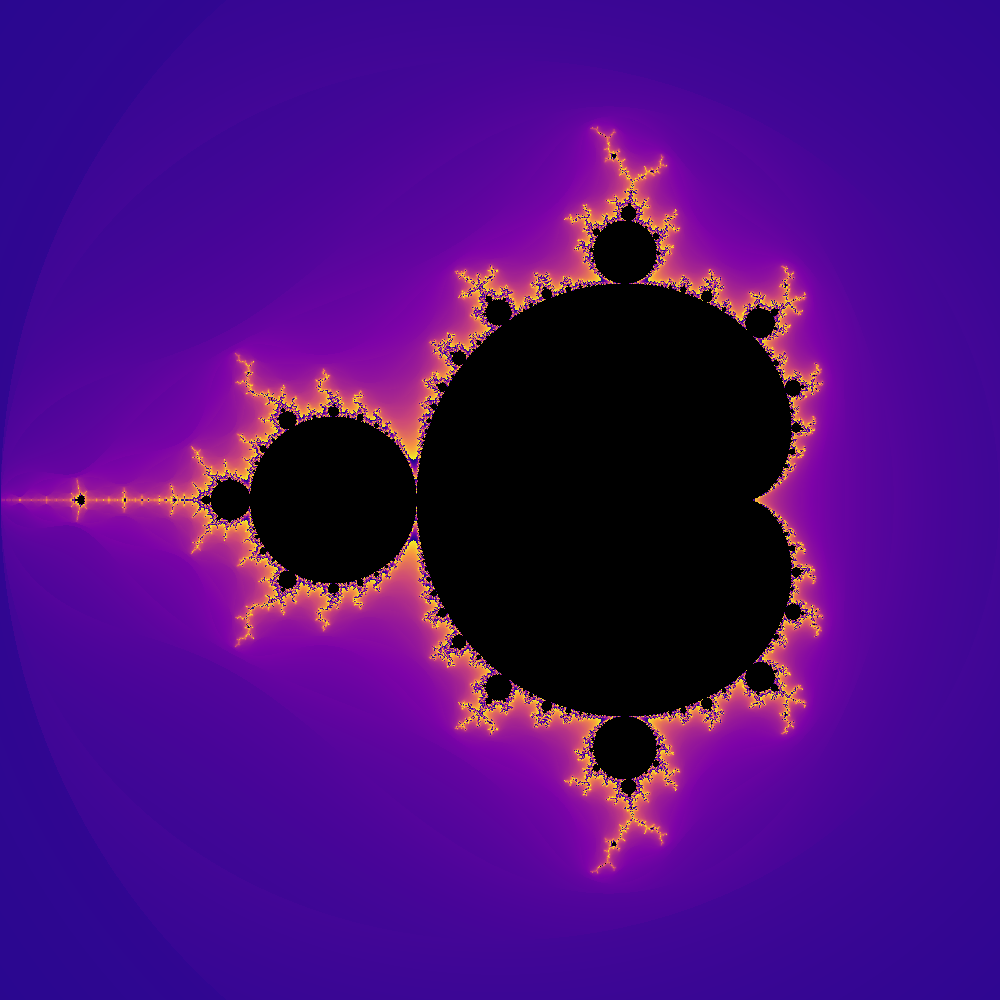
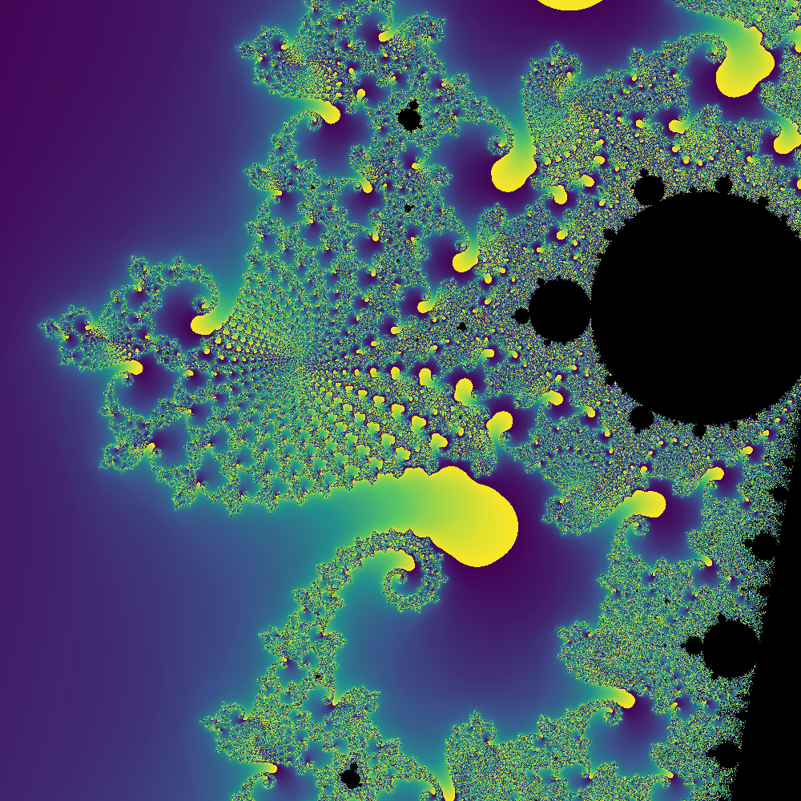
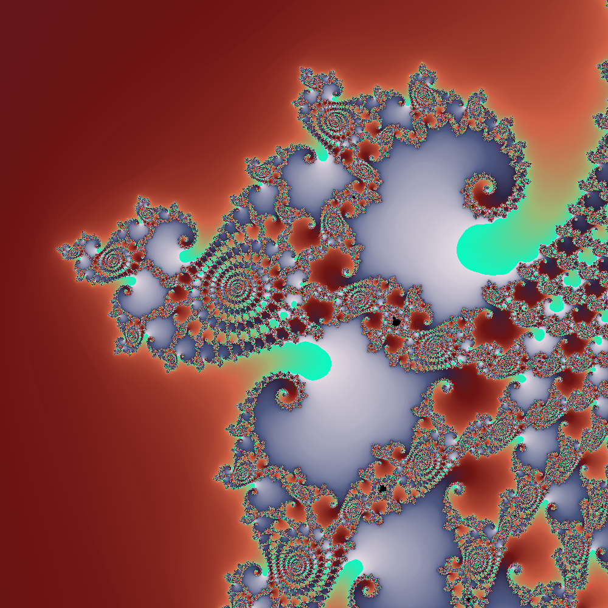
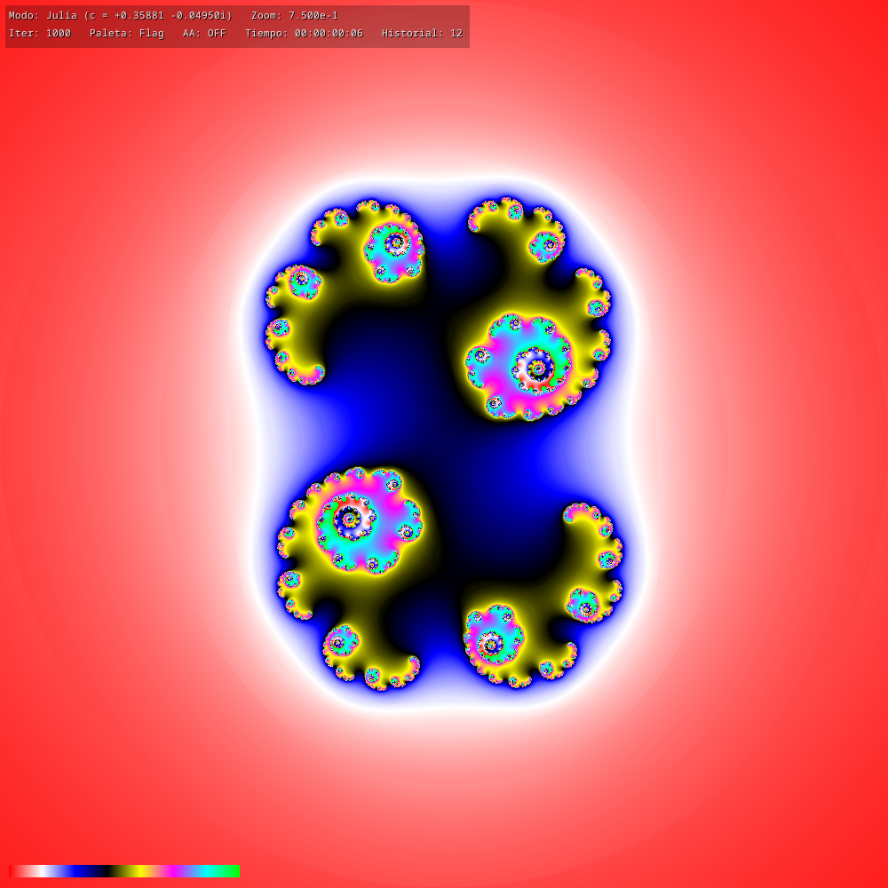
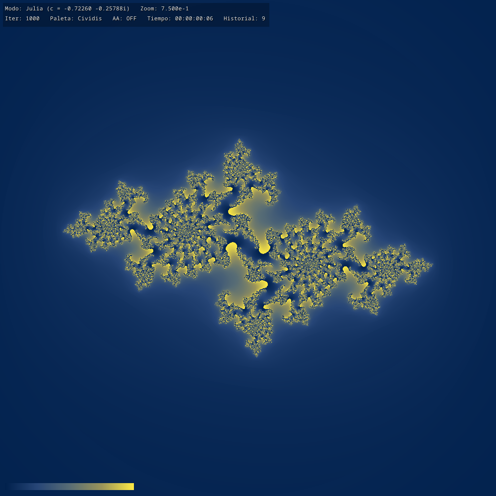
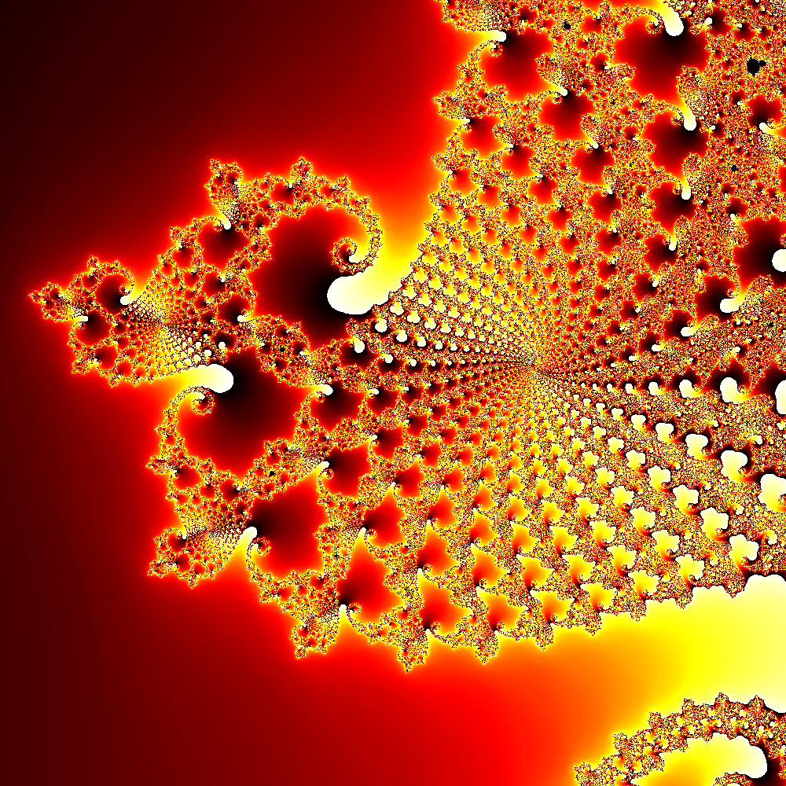
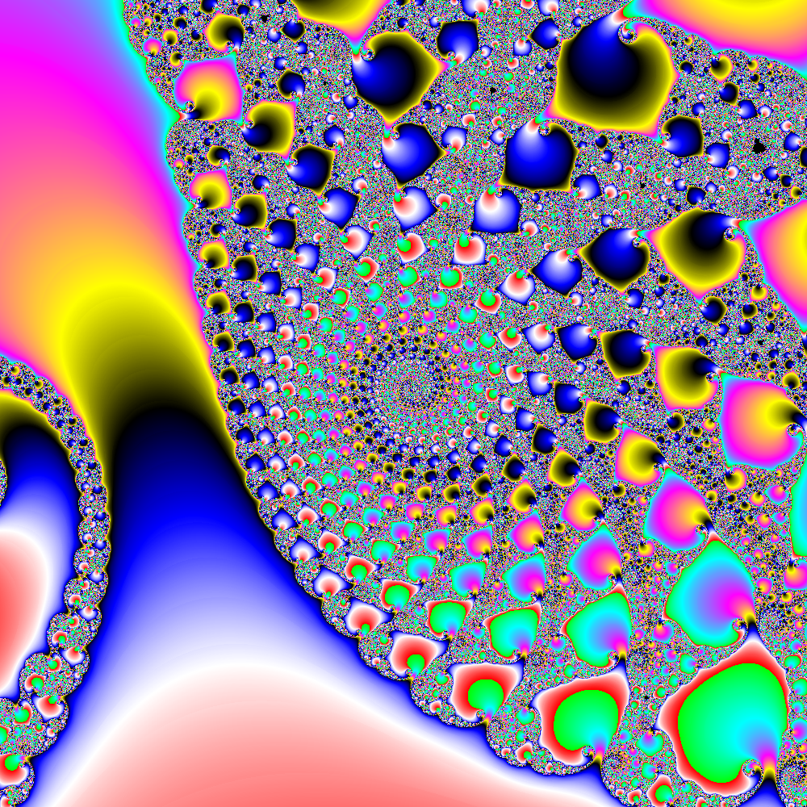

# Mandelbrot & Julia Explorer (Rust)

<p align="center">
  
  ...
</p>

> 🌐 **Read this in other languages:** **English** · [Español](README.md)

<p align="center">
  
  
  
  
  
  
  
  
</p>

Interactive explorer for the **Mandelbrot** and **Julia** sets written in Rust.
It lets you navigate the complex plane with continuous zoom and pan, jump from
Mandelbrot to the Julia set associated with any point, switch color palettes,
adjust the number of iterations, enable antialiasing, save PNG snapshots, save
and reload the session state, and record frame sequences for video composition.


---

## Features

- **Parallel rendering** with [Rayon](https://crates.io/crates/rayon): splits the
  image rows across all CPU cores automatically.
- **Asynchronous rendering on a separate thread**: fractal computation lives in
  its own thread, so the window keeps responding to keyboard and mouse even when
  a frame takes a while to complete. Obsolete renders are discarded as soon as a
  newer one arrives.
- **Two fractals, one engine**: Mandelbrot (parameter plane `c`) and Julia
  (dynamic plane `z` for a fixed `c`). The iteration `z ← z² + c` is identical;
  only the variable that sweeps the plane changes.
- **Interactive Mandelbrot → Julia jump** with the `J` key: the point under the
  cursor (or the center if the mouse is outside the window) becomes the `c`
  parameter of the corresponding Julia set.
- **Back to Mandelbrot** with `M`, restoring the last frame you were viewing
  (center and zoom are preserved).
- **Continuous zoom with the mouse wheel**, centered on the cursor. Wheel up
  zooms in, wheel down zooms out.
- **Zoom ×2 with left click**, centered on the clicked point.
- **Pan by dragging with the left button**: a click without dragging zooms,
  dragging shifts the view.
- **Preview while dragging**: during a drag the render is done at half
  resolution and scaled to the final size, so panning feels immediate; when you
  release, the full render is launched.
- **Smoothed coloring** (*smooth coloring*) to avoid the typical visible bands
  of the fractal.
- **Cycle detection in Julia sets**: points that converge to an attracting cycle
  are detected by comparing the orbit with the one from 20 iterations before and
  are marked as interior without exhausting `max_iter`.
- **Antialiasing 2×2 toggleable with `A`**: 4 samples per pixel averaged.
- **10 color palettes** cyclable, ordered from smoothest to most aggressive:
  `Cividis`, `Viridis`, `Inferno`, `Plasma`, `Turbo`, `Twilight`, `HSV`, `Hot`,
  `Flag` and `Grayscale`.
- **Help window with `F1`**: opens a secondary window with the full list of
  controls. Pressing `F1` again toggles between Spanish and English.
- **Legend with antialiased font** (*Noto Sans Mono*): much more readable than
  traditional 8×8 bitmap fonts.
- **Undo** with a history buffer that crosses mode changes
  (Mandelbrot ↔ Julia).
- **Iteration adjustment** in steps of 1000 on the fly.
- **Save and load session state** in JSON (`F5` / `F9`): viewport center, mode,
  Julia's `c`, iterations, palette and AA state.
- **PNG frame sequence recording** at 30 fps (`V`) to compose video with
  `ffmpeg`, with sequentially numbered filenames.
- **Auto-zoom** with `Z`: the view slowly zooms in towards the center
  continuously, designed for recording zoom sequences without touching the mouse.
- **PNG export** of the current view (with or without the legend).
- **On-screen legend** with active mode, center coordinates, zoom level,
  iterations, active palette, AA state, render time, history size, recording
  indicator and **complex coordinates of the point under the cursor** in real
  time.

## Requirements

### Operating system

| OS | Status | Notes |
|---|---|---|
| Linux + X11 | ✅ Supported | Native X11 backend |
| Linux + Wayland (KDE, GNOME) | ✅ Supported | Through Xwayland (X11 backend) |
| Linux + Wayland (Cosmic, others) | ⚠️ With caveats | DPI scaling may leave a black stripe; see Known limitations |
| Windows 10/11 | ✅ Supported | Win32 backend (`minifb` default) |
| macOS 11+ | ✅ Supported | Cocoa backend (`minifb` default) |

It does not run on pure Wayland without Xwayland enabled.

### Hardware

| Component | Minimum | Recommended |
|---|---|---|
| CPU | x86_64 or ARM64 | Multicore (Rayon splits the work) |
| RAM | 2 GB (1 GB free during compilation) | 4 GB |
| Disk | 500 MB free for `target/` | 1 GB |
| GPU | Not needed (100 % CPU render) | — |
| Display | 1024×768 | 1920×1080 or higher |

### Software

- **Rust** 1.85 or higher (2024 edition), installable via
  [rustup](https://rustup.rs/).
- **System linker**:
  - Linux (Debian/Ubuntu): `sudo apt install build-essential`
  - Linux (Fedora): `sudo dnf groupinstall "Development Tools"`
  - Linux (Arch): `sudo pacman -S base-devel`
  - Windows: [Visual Studio Build Tools](https://visualstudio.microsoft.com/visual-cpp-build-tools/)
    with the "Desktop development with C++" workload.
  - macOS: Xcode Command Line Tools (`xcode-select --install`).
- **X11 development libraries** (Linux only):
  - Debian/Ubuntu: `sudo apt install libx11-dev libxkbcommon-dev libxcb1-dev`
  - Fedora: `sudo dnf install libX11-devel libxkbcommon-devel libxcb-devel`
  - Arch: `sudo pacman -S libx11 libxkbcommon libxcb`

On most Linux desktops these libraries are already installed; they are only
needed explicitly on minimal installations or containers.

On Windows and macOS no additional dependencies are required: `minifb` uses
the system APIs (Win32 and Cocoa respectively).

## Installation

```bash
git clone https://github.com/fserradilla65-afk/mandelbrot-rust.git
cd mandelbrot-rust
cargo build --release
```

## Controls

| Action | Key / mouse |
|---|---|
| Continuous zoom centered on cursor (up zooms in, down zooms out) | Mouse wheel |
| Zoom ×2 on the point | Left click |
| Pan (drag the view) | Drag with left button |
| Undo | Right click / `U` |
| **Julia from the point under the cursor** | `J` (Mandelbrot only) |
| **Back to last Mandelbrot** | `M` (from Julia) |
| Increase iterations (+1000) | `I` |
| Decrease iterations (−1000) | `O` |
| Change palette | `P` |
| Toggle antialiasing | `A` |
| Auto-zoom on / off | `Z` |
| Record / stop frame sequence | `V` |
| Save PNG snapshot (no legend) | `S` |
| Save PNG snapshot (with legend) | `Shift` + `S` |
| Save session state | `F5` |
| Load session state | `F9` |
| **Open help window / toggle language (ES/EN)** | `F1` |
| Reset to initial state | `R` |
| Quit | `Esc` |

### Notes on `J` and `M`

- **`J`** only acts in Mandelbrot mode. It takes the complex coordinates of the
  pixel under the cursor (or of the center if the mouse is outside the window)
  and jumps to the corresponding `J_c` with an initial frame `[-2, 2]²`.
- **`M`** returns to the **last Mandelbrot frame** you were viewing, not to the
  initial one. This way you can enter a Julia set, explore it and come back
  without losing the zoom you had. If you started directly in Julia mode from
  the command line, `M` takes you to the initial Mandelbrot (because there was
  no previous one).
- **`U`** and right click undo step by step, and **cross mode changes**: if you
  jumped from Mandelbrot to Julia and then zoomed inside the Julia set, the
  successive `U` presses walk back through that history in reverse order.

### Notes on mouse interaction

- A **click** (press and release without moving) on the left button zooms ×2 on
  the point where it was pressed.
- A **drag** (moving the mouse more than 3 pixels before releasing) pans.
  While you drag, the render is done at half resolution so the image responds
  immediately; on release, the full frame is recomputed.
- The **wheel** applies a continuous multiplicative zoom: rolling up zooms in,
  rolling down zooms out. The complex point under the cursor remains fixed
  during the zoom.

### Help window (`F1`)

Pressing `F1` opens a secondary window with the full list of controls, intended
as a quick reference without leaving the program. Pressing `F1` again toggles
between Spanish and English. The help window is independent of the main one: it
can be moved, covered by other windows or left behind without affecting the
fractal render.

### Palettes

The `P` cycle walks the palettes in order **from smoothest and most uniform to
most aggressive**, always ending on grayscale:

→ Cividis → Viridis → Inferno → Plasma → Turbo → Twilight → HSV → Hot → Flag → Grayscale → (back to Cividis)

| Palette | Type | Notes |
|---|---|---|
| **Cividis** | Sequential | Blue → gray → yellow. Optimized for color blindness. |
| **Viridis** | Sequential | Perceptually uniform, muted and elegant tones. |
| **Inferno** | Sequential | Perceptually uniform, warm but contained. |
| **Plasma** | Sequential | Perceptually uniform, more vibrant (purples and oranges). |
| **Turbo** | Sequential | Google's "improved" rainbow, saturated colors. |
| **Twilight** | Cyclic | Light extremes, dark center, marked contrasts. |
| **HSV** | Cyclic | Pure HSV wheel: red → yellow → green → cyan → blue → magenta → red. |
| **Hot** | Sequential | MATLAB classic: black → red → yellow → white. |
| **Flag** | Cyclic | 8 pure colors without transitions, ideal for seeing iteration loops. |
| **Grayscale** | Sequential | Pure grayscale. |

The first three (Cividis, Viridis, Inferno) are the most suitable for "serious"
captures: perceptually uniform, accessible and without visual noise. The middle
ones (Plasma, Turbo, Twilight) add color and intensity. The last ones (HSV,
Hot, Flag) are the most striking and colorful, useful for exploration or videos
but potentially saturated for printing.

### Snapshots

Pressing `S` saves the current image (without legend or palette bar) as a
`.png` in the user's pictures folder:

- Linux: `~/Pictures/Capturas/` (or `~/Imágenes/Capturas/` in Spanish locales).
- Windows: `C:\Users\<user>\Pictures\Capturas\`.
- macOS: `~/Pictures/Capturas/`.

Pressing `Shift+S` saves the image **with** legend and palette bar. The
filename includes a timestamp in seconds and a tag for the capture type
(`mandelbrot_<ts>_clean.png` or `mandelbrot_<ts>_legend.png`).

### State save and load

`F5` saves the current session state to a JSON file in the same `Capturas/`
folder:
Capturas/mandelbrot_state.json

The JSON includes:

- Viewport center (`center_x`, `center_y`) and half-extents (`half_width`,
  `half_height`).
- Current mode (Mandelbrot or Julia with its `c` parameter).
- Maximum number of iterations.
- Active palette.
- Antialiasing state.

`F9` restores that state and re-renders the view. Useful to come back to an
interesting point the next day, or to share a specific framing with someone
else.

### Video recording

Pressing `V` starts recording a PNG frame sequence at 30 fps. Files are saved
to:
Capturas/frames_<timestamp>/frame_00000.png
Capturas/frames_<timestamp>/frame_00001.png
...

Each frame is saved with the same content you see on screen (including the
legend). To stop the recording, press `V` again; the program prints the total
frame count and the folder where they were saved to the terminal.

To assemble the video with `ffmpeg`:

```bash
ffmpeg -framerate 30 -i frame_%05d.png -c:v libx264 -pix_fmt yuv420p zoom.mp4
```

Combined with `Z` (auto-zoom) you can record a continuous zoom without touching
the mouse: press `Z` to start the zoom, `V` to start recording, let it run, and
when finished press `V` to stop and `Z` to disable auto-zoom.

## Project structure

```
mandelbrot-rust/
├── Cargo.toml
├── src/
│   ├── main.rs        # event loop and frame composition
│   ├── cli.rs         # command-line argument parsing
│   ├── fractal.rs     # FractalKind + iteration (cardioid, bulb, cycles)
│   ├── palette.rs     # Palette + LUT + RGB anchor data
│   ├── viewport.rs    # Viewport, zoom_at, pan_pixels, pixel_to_complex
│   ├── render.rs      # RenderParams + render + Renderer (async thread)
│   ├── state.rs       # State, Snapshot, SavedState (save/load)
│   ├── ui.rs          # antialiased text, palette bar, overlay, help
│   └── png.rs         # PNG saving + FrameRecorder
├── Capturas/          # Created when pressing S or V (not versioned)
└── README.md
```

Each module has a clear responsibility and can be tested separately:

- **fractal** — `enum FractalKind { Mandelbrot, Julia { c } }` and the
  `iterate` iterator, with analytic checks for the main cardioid and the
  period-2 bulb, and cycle detection by comparison with the previous orbit.
- **palette** — `enum Palette` with 10 variants, the `color(t)` function and a
  `PaletteLut` that precomputes 2048 entries to index in the render loop.
- **viewport** — region of the complex plane to render, with specific
  constructors for Mandelbrot and Julia, pixel ↔ complex conversion, zoom on a
  point and pixel shift.
- **render** — `RenderParams` groups everything needed for a frame; `render`
  executes it with Rayon; `Renderer` manages the background thread, the request
  queue with obsolete frame discarding and the result collection.
- **state** — all the mutable state of the program in a single struct, with the
  transitions (`jump_to_julia`, `back_to_mandelbrot`, `undo`, `reset`) and JSON
  serialization.
- **ui** — character drawing with Noto Sans Mono (real antialiasing), legend
  composition, palette bar, help window and time formatting utilities.
- **png** — PNG saving with `image` and `FrameRecorder` for sequences.
- **cli** — parsing of `mandelbrot-rust [cx cy [zoom]]` and
  `mandelbrot-rust julia <cr> <ci> [zoom]`.
- **main** — event loop, mouse and keyboard reading, help window management
  (`F1`) and calls to the previous modules.

## Dependencies

| Crate | Version | Use |
|---|---|---|
| minifb | 0.28.0 | Window and event loop. On Linux the X11 backend is forced (`default-features = false, features = ["x11"]`); on Windows and macOS it uses the native backend. |
| rayon | 1.12.0 | Data parallelism in the render (splits rows across all cores). |
| num-complex | 0.4.6 | `Complex<f64>` type to represent Julia's `c` parameter and for viewport arithmetic. |
| image | 0.25.10 | PNG encoding for snapshots (`default-features = false, features = ["png"]`). |
| noto-sans-mono-bitmap | 0.3 | Bitmap font with real antialiasing (size 16, regular weight) for the legend and help window. |
| dirs | 5.0.1 | Cross-platform resolution of the user's pictures folder. |
| serde | 1.0 | Serialization of `Viewport`, `FractalKind`, `Palette` and `SavedState`. |
| serde_json | 1.0 | JSON format for saving and loading session state. |

Note: `font8x8` is no longer used. If you came from an earlier version, you can
remove it from `Cargo.toml`.

## Known limitations

**Native Wayland not supported on Linux.** The app forces `minifb`'s X11
backend, which works through Xwayland. As a consequence, it will not start on
Wayland compositors without Xwayland enabled (uncommon on user desktops).

**In recent Wayland compositors (observed in Cosmic, and potentially occurring 
in others that delegate X11 scaling to the compositor without notifying the client), 
the window may appear with a black strip to the right and below the fractal. 
This happens because the compositor applies a scaling factor (125%, 150%, etc.) 
to the window's physical area, while the app continues to render its buffer at a 1:1 ratio.

**DPI scaling on young Wayland compositors.** On recent Wayland compositors
(observed on Cosmic; may also happen on others that delegate X11 scaling to the
compositor without notifying the client), the window may show a black stripe to
the right and bottom of the fractal. The cause is that the compositor applies a
scale factor (125 %, 150 %…) to the physical window area, while the app keeps
rendering its buffer 1:1.

Tested workarounds:

- Use KDE Plasma (Wayland or X11): X11 app scaling works correctly and the
  stripe does not appear.
- On KDE: *System Settings → Display and Monitor → Display Configuration →
  Legacy Applications (X11) → "Apply scaling themselves"*.
- Launch with `WINIT_X11_SCALE_FACTOR=1 ./mandelbrot-rust` if the compositor
  respects that variable.

**Harmless warning on close (Linux/Wayland).** When exiting, messages like
`queue 0x... destroyed while proxies still attached` may appear in the terminal.
They are emitted by the Wayland/Xwayland layer when releasing resources and do
not indicate a real error.

**The help window (`F1`) is not modal.** It is an independent window that can go
behind the main one if you click on the latter. To see it again, bring it to the
front with the window manager or close it and reopen it with `F1`.

**Precision limited to f64.** Allows zooms up to a factor of ~10¹³–10¹⁵
depending on the region explored. Beyond that, increasingly pixelated images
appear. This limit applies to both Mandelbrot and Julia. Neither perturbation
theory nor double precision has been implemented, which would be needed to go
further.

**No programmatic window positioning.** `minifb` does not expose a
cross-platform API for this. If the window appears misplaced, move it manually
with the window manager. This also applies to the help window.

**Changing Julia requires going back to Mandelbrot.** The `J` key only acts in
Mandelbrot mode to avoid the ambiguity of "which `c` do I take?". If you want
another Julia, press `U` (or `M`) and pick another point.

**Optional 2×2 antialiasing.** Toggled with `A`. With AA on, each frame is
computed with 4 samples per pixel; with AA off, 1.

**Cycle detection only applies to Julia.** In Mandelbrot, interior points are
detected by cardioid/bulb or by exhausting `max_iter`.

## Acknowledgements

The Viridis, Inferno, Plasma, Turbo and Cividis palettes come from the
Matplotlib project, which in turn is based on the work of Nathaniel Smith,
Stéfan van der Walt, Bastian Bechtold and others.

Hot, Flag and Jet are inherited from MATLAB / IDL.

The antialiased bitmap font used in the interface is Noto Sans Mono, distributed
by Google under the SIL Open Font License.

The Julia set and its relation to the Mandelbrot set (connectedness of J_c as a
function of the critical orbit of c) are classic results of complex dynamics;
see for example *Complex Dynamics* by Carleson and Gamelin, or the works of
Douady and Hubbard.

The analytic detection of the main cardioid and the period-2 bulb follows the
classic criterion described in the reference documentation of the Mandelbrot
set (for example, in *The Science of Fractal Images* by Peitgen and Saupe).

## License

This project is distributed under the MIT license. See the LICENSE file for the
full text.
